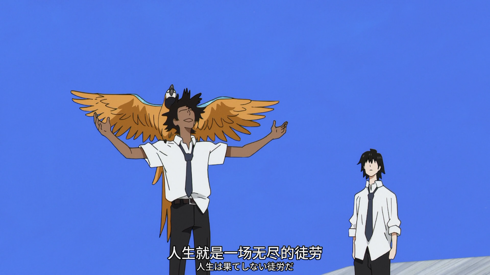
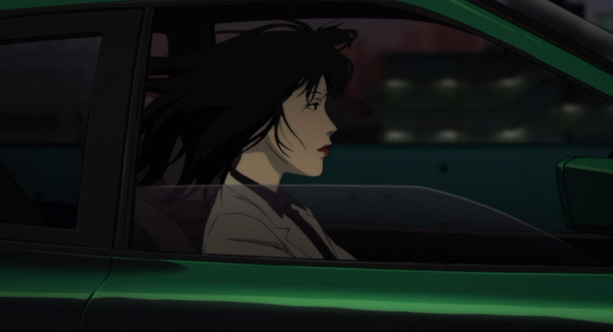
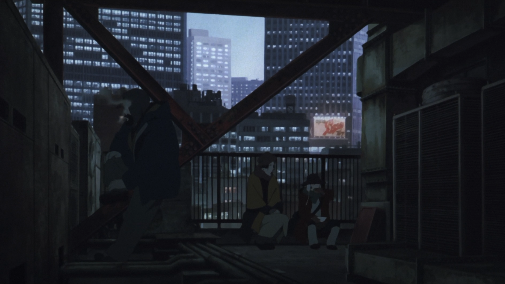
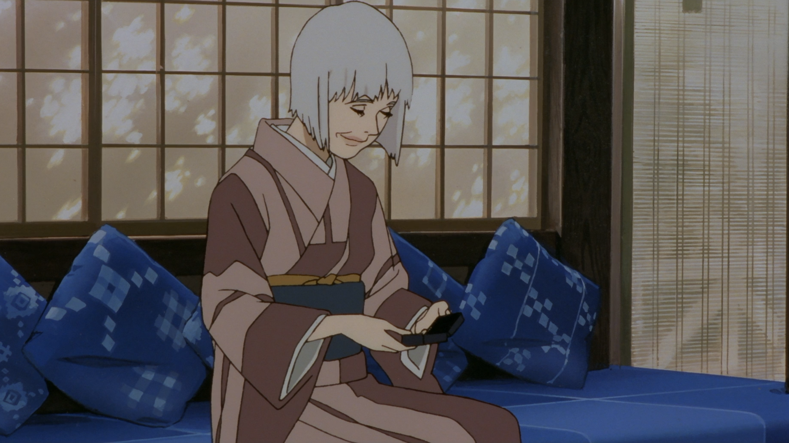
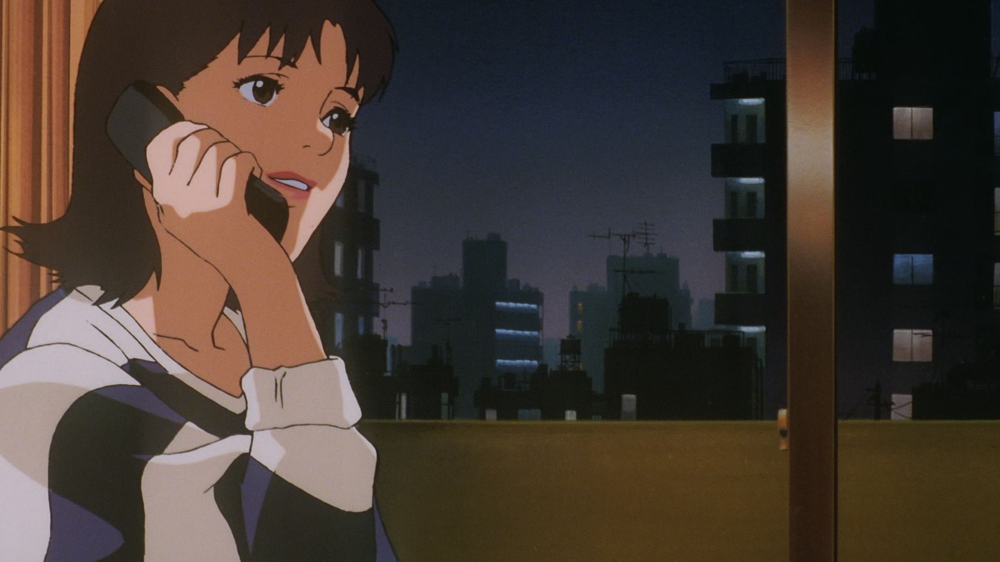

今年不知不觉看了好多电影和番剧，总是想把自己喜欢的记录下来，但是心中的感动又不知道从何说起。
说起安利，我觉得是件挺难的事情，想说的话很多，但最后发现自己什么都说不出来，只能感到自己的语言贫瘠。

## 番剧
#### 地-关于地球的运动-

今年看完非常有感触的一部番。从故事里收获了巨大的感动，人类纯粹而原始的求知欲，和夜空中的星星一样闪耀，倘若我回到地动说还未被证实的一年，我又会多么多么震撼。即便这部番有着瑕疵，但在我心中已经足够满分。之后看了 “[金黄的树林里分出两条路](https://www.bilibili.com/video/BV1jyhYznE5h)”这篇手书，更是百感交集，难以言表。

#### 漂流少年

初看这部番的时候，我并没有带有很高的预期，可故事走向和结尾都太令人痴迷。有人说：“整部番就是一场短暂的彩虹泡泡梦，醒来之后不停地留恋……”

故事很自然地引出了存在主义、虚无主义，同时又带有青春时期的忧郁。叙事与画面都很精美简洁，如此简洁却涵盖了很多，从秩序到美梦般的虚无，让人们开始被迫思考人生的意义：有人斗争，有人停滞不前，有人沉溺美梦，也有人勇敢面对。

主角在故事中切切实实地成长了，坦然地接纳了现实，也走出了这场梦境；可作为观众的我，却还没能从中走出来。罗曼·罗兰的那句名言：“世界上只有一种真正的英雄主义，那就是认清生活的真相后依然热爱生活。”用在这里再合适不过了。

> “我们太迷恋结尾了。这个世界有那么多伟大的生命和美好的爱可以见证和体验，但是只要结局不尽如人意，我们立刻觉得这是悲剧。或者正好相反，只要结局有一刻的救赎，一生的不公和痛苦都可以忽略不计。只看结果，其他都不重要吗？”——《抓落叶》

#### 今敏（红辣椒+东京教父+千年女优+未麻的部屋）

[grid]

[/grid]

很遗憾今敏导演已经离世了。回顾他的作品，各种奇思妙想极其精彩，视听的表现力更是到了极致。

在《红辣椒》里，现实中喜欢漫步的感觉被 OP 展现得淋漓尽致，看的时候实在感慨万千；《东京教父》那极高水平的作画与故事，吸引着我从头看到尾，十分有趣；《千年女优》的故事与镜头语言简直和电影一模一样，主题也深得我心；而《未麻的部屋》则是那些令人完全意料不到的故事发展。

能把故事做到这种“梦幻与现实交织”的，也就只有今敏了，倘若他没有离世该有多好，好在留下的这些佳作，也算没有太多遗憾。

